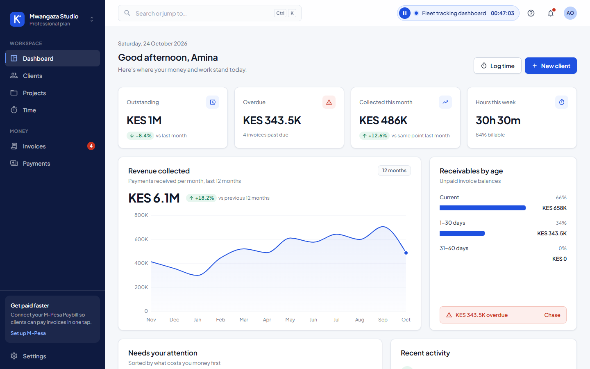
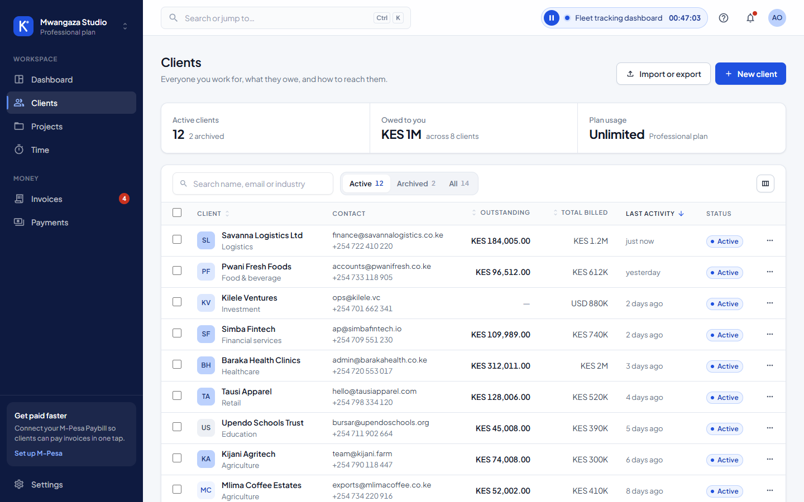
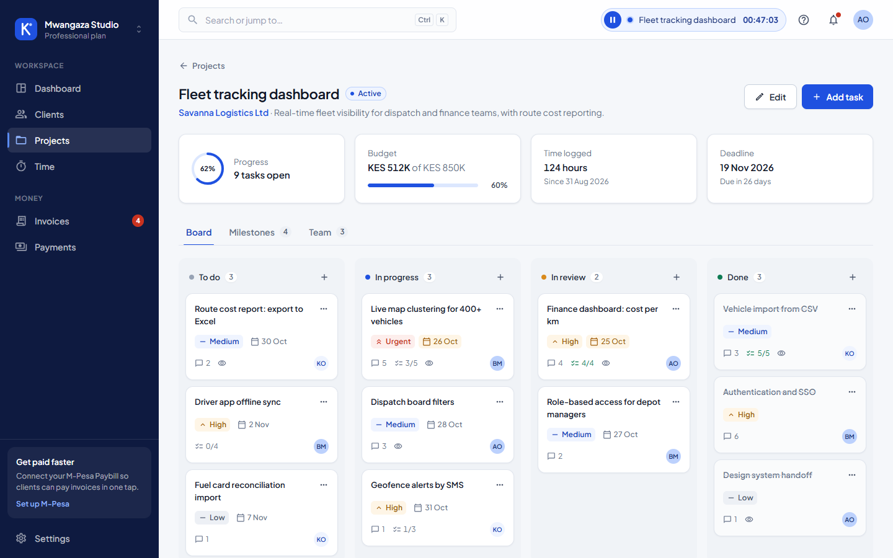
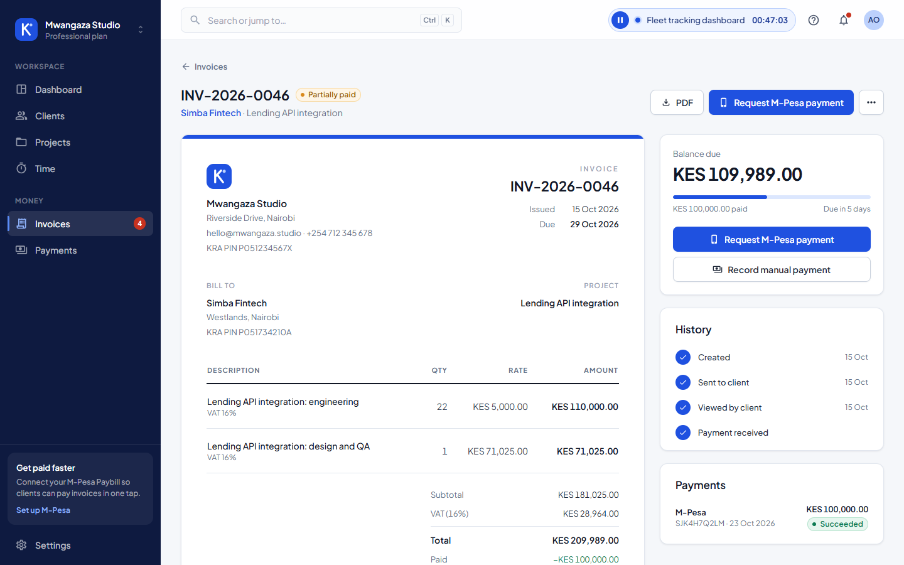
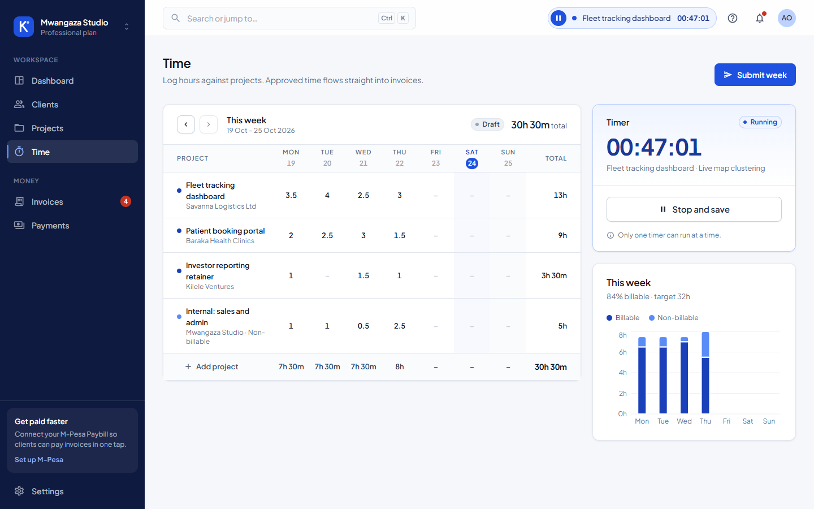

# KaziPay

[](https://github.com/Scientistlucy/KaziPay/actions/workflows/ci.yml)

KaziPay is a modular monolith for consultants and small agencies to manage client work, time, invoices, and payments.

> Do the work. Get paid.



<table>
  <tr>
    <td></td>
    <td></td>
  </tr>
  <tr>
    <td></td>
    <td></td>
  </tr>
</table>

## Project Status

The project is being built in the order defined by the specifications:

- Step 1: Foundation - complete
- Step 2: Tenancy core - complete
- Step 3: Platform plumbing - complete
- Step 4: Identity - complete
- Step 5: Tenant settings - complete
- Step 6: Clients - complete
- Step 7: Projects, members, milestones - next

**Frontend:** the full staff app UI is built on the design system in [docs/DESIGN_SYSTEM.md](docs/DESIGN_SYSTEM.md). It covers sign-in, registration, dashboard, clients, projects with a Kanban board, the timesheet, invoices with the M-Pesa payment flow, payments and settings. Screens read typed sample data through TanStack Query hooks (`src/lib/queries.ts` → `src/mocks`). Each backend step replaces its mock fetchers with real API calls without touching components.

The database is delivered through versioned Flyway migrations alongside each build step. The current migrations (V1–V4, V9, V11, V12) cover the foundation, tenancy and platform plumbing, identity, clients, and tenant settings. A shared development database runs on Neon. See [docs/DATABASE_SETUP.md](docs/DATABASE_SETUP.md).

## Technology

### Backend

- Java 21
- Spring Boot 3.5.x
- Spring Modulith
- Spring Data JPA and JDBC
- PostgreSQL 16
- Flyway
- MapStruct and Lombok
- Spring Security with RS256 JWTs
- Testcontainers and JUnit 5

### Frontend

- React
- TypeScript
- Vite
- Tailwind CSS
- React Router
- TanStack Query
- Axios
- Radix UI primitives, cmdk command palette
- React Hook Form and Zod
- Recharts
- Material icons (react-icons) and Plus Jakarta Sans
- Vitest and Testing Library

### Local infrastructure

- PostgreSQL
- Redis
- MinIO
- MailHog

## Repository Structure

```text
.
|-- backend/
|   |-- pom.xml
|   |-- .mvn/settings.xml
|   `-- src/
|       |-- main/java/com/kazipay/
|       |   |-- common/       # shared API, tenant, security, crypto, outbox, audit
|       |   |-- identity/     # authentication, roles, permissions, identity API
|       |   |-- tenant/       # workspace settings, tax rates, onboarding, entitlements
|       |   |-- clients/      # clients, contacts, CSV import/export, portal invites
|       |   `-- KaziPayApplication.java
|       |-- main/resources/
|       |   |-- application.yml
|       |   `-- db/migration/ # immutable Flyway migrations
|       `-- test/
|-- frontend/
|   |-- package.json
|   |-- src/
|   |   |-- components/ui/    # design-system components (Button, Field, DataTable, Modal...)
|   |   |-- components/layout/# app shell, sidebar, command palette, timer
|   |   |-- components/charts/# revenue, aging and hours charts
|   |   |-- features/         # feature-specific forms and widgets
|   |   |-- pages/            # one lazily loaded module per route
|   |   |-- lib/              # query hooks, API client, formatting
|   |   |-- mocks/            # typed sample data until API integration
|   |   |-- test/             # test setup and render helper
|   |   `-- App.tsx
|   `-- vite.config.ts
|-- infra/
|   |-- docker-compose.yml
|   `-- db/init.sql
|-- docs/
|   |-- KAZIPAY_PROJECT_SPEC.md
|   |-- KAZIPAY_BACKEND_SPEC.md
|   |-- TESTING_AND_CI.md
|   |-- ERROR_LOG.md
|   |-- DECISIONS.md
|   |-- DATABASE_SETUP.md
|   |-- DESIGN_SYSTEM.md      # frontend tokens, components and page patterns
|   `-- ...
|-- .github/workflows/ci.yml  # backend verify + frontend build/test
|-- .cursorrules
`-- README.md
```

## Architecture Rules

- Build as a modular monolith; do not split into microservices prematurely.
- Package by module: `com.kazipay.<module>`.
- Modules communicate through public APIs or domain events only.
- Controllers call services; services call repositories.
- DTOs are used at module and HTTP boundaries. JPA entities never leave their module.
- Use `BigDecimal` for money and PostgreSQL `NUMERIC(14,2)` for stored amounts.
- Every tenant table has `tenant_id` and forced PostgreSQL Row-Level Security.
- Every new table requires a new Flyway migration. Applied migrations are immutable.
- Side-effect POST requests use idempotency keys where specified.
- Secrets and credentials must never be committed or logged.
- Each feature must include unit and integration tests.

The complete working rules are in [.cursorrules](.cursorrules). The specifications in [docs/](docs/) are the source of truth.

## Local Setup

### Prerequisites

- Java 21
- Maven 3.10+
- Node.js 22+
- Docker Desktop for PostgreSQL/Testcontainers integration tests

### Start infrastructure

```powershell
docker compose -f infra/docker-compose.yml up -d
```

### Run the backend

By default the backend connects to the Docker Compose database. To use the shared Neon database instead, copy `backend/.env.example` to `backend/.env` and fill it in (see [docs/DATABASE_SETUP.md](docs/DATABASE_SETUP.md)). Flyway migrates as `kazipay_owner` and the app runs as `kazipay_app`.

```powershell
Push-Location backend
mvn -s .mvn\settings.xml spring-boot:run
Pop-Location
```

### Run the frontend

```powershell
Push-Location frontend
npm install
npm run dev
Pop-Location
```

## Testing

Backend unit tests (fast, no Docker needed):

```powershell
Push-Location backend
mvn -s .mvn\settings.xml test
Pop-Location
```

Backend unit and integration tests. `*IT` classes use Testcontainers PostgreSQL and need Docker:

```powershell
Push-Location backend
mvn -s .mvn\settings.xml verify
Pop-Location
```

The integration suites check that every tenant table forces row-level security, that the app role cannot bypass it, and that one tenant cannot read or change another tenant's data. GitHub Actions runs `mvn verify` and the frontend checks on every push and pull request.

Frontend build and tests:

```powershell
Push-Location frontend
npm run build
npm test
Pop-Location
```

The Maven settings file points dependencies to a writable user-local cache because the default Maven cache on the development machine is restricted.

## Database and tenancy

The application uses one PostgreSQL database with shared tables, `tenant_id`, and forced RLS. The local Compose setup creates a migration owner role and a restricted application role. The application role must not own tables and must not have `BYPASSRLS`.

Tenant context is established before a transaction begins. The tenant-aware datasource sets `app.tenant_id` when a connection is borrowed and clears it before the connection returns to the pool.

## Security Notes

- Never commit `.env` files, keys, passwords, gateway credentials, or tokens.
- Development JWT signing keys are generated at startup until environment-backed key configuration is added.
- Refresh tokens are opaque, hashed, rotated, and stored in tenant scope.
- Public and one-time tokens are stored as hashes and expire.

## Build Order

The authoritative build order is Section 19 of [KAZIPAY_PROJECT_SPEC.md](docs/KAZIPAY_PROJECT_SPEC.md) and Section 17 of [KAZIPAY_BACKEND_SPEC.md](docs/KAZIPAY_BACKEND_SPEC.md). Work on one step at a time and keep the build green before moving forward.

## License

MIT. See the project specifications and repository history for project decisions and implementation status.